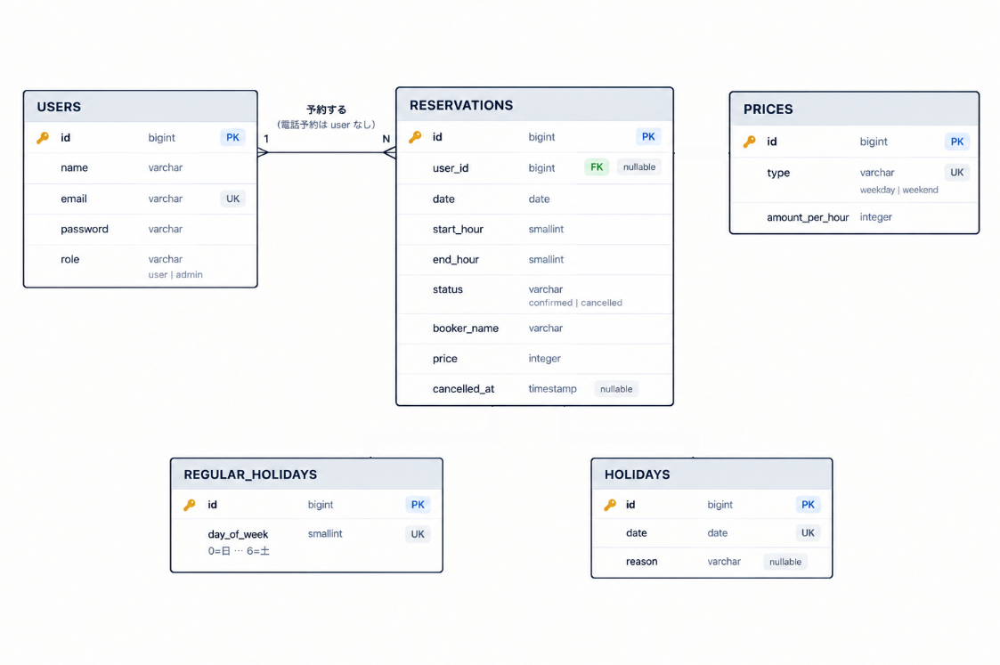

# FUTSAL PARK

Laravel + Next.js 構成の、フットサルコート1面の予約サイトです。利用者は空き状況を見て Web で予約し、管理者は予約の確認・電話予約の代理登録と、料金・定休日・臨時休業日の設定を行います。

## デモ

- 公開ページ: https://frontend-production-3301.up.railway.app

## ER図



## 主な機能

- 週単位の空き状況カレンダー（1時間枠、2〜4時間の予約。今日から1か月先まで）
- 予約・キャンセル（マイページで自分の予約を一覧。予約確定・キャンセル時にメール送信）
- 会員登録・ログイン・プロフィール編集（Sanctum SPA Cookie 認証、ログイン試行のレート制限つき）
- 管理画面: 全予約のカレンダー表示・キャンセル、電話予約の代理登録、会員検索
- 管理画面: 料金（平日／土日）・定休日・臨時休業日の設定（臨時休業日に予約がある場合は確認してから登録）
- 二重予約と「会員は1日1件まで」を、同時に申し込まれても DB の制約で守る
- 3か月より古い予約は毎日自動で削除

意図的にスコープ外にしたもの: オンライン決済、パスワードリセット・メール認証、複数コート、祝日の判定

## 技術スタック

| 層             | 技術                                                                                                                                 |
| -------------- | ------------------------------------------------------------------------------------------------------------------------------------ |
| バックエンド   | Laravel 13 / PHP 8.4 / Laravel Sanctum（SPA Cookie 認証）/ Pest / Laravel Pint / Larastan                                            |
| フロントエンド | Next.js 16（App Router・Cache Components）/ React 19 / TypeScript / Tailwind CSS 4 / TanStack Query / react-hook-form + zod / Jest + Testing Library + MSW |
| DB・キャッシュ | PostgreSQL 15 / Redis 7                                                                                                              |
| メール         | Resend（本番）/ Mailpit（ローカル）                                                                                                  |
| インフラ       | Railway（Dockerfile ビルド、GitHub 連携による自動デプロイ）/ Docker Compose（ローカル）/ GitHub Actions（CI）                        |

## アーキテクチャ

```
backend/    Laravel — ビューを持たない純粋な JSON API と、キューの worker・scheduler
frontend/   Next.js（App Router）
docs/       設計書
docker-compose.yml  ローカル開発用
```

- 本番は Railway に backend / worker（メール送信・キャッシュ再検証の通知）/ scheduler（古い予約の削除）/ frontend / PostgreSQL / Redis の6サービスをデプロイ。worker と scheduler は backend と同じイメージを使う。
- Next.js の `rewrites()` で `/api`・`/sanctum` を backend へ転送し、ブラウザからは常に同一オリジンに見える構成にしている。別ホスト名の Railway でも Sanctum の Cookie 認証がそのまま動く。
- データの性質ごとにキャッシュの方法を変えている。

| データ | 方法 | 理由 |
| --- | --- | --- |
| 施設情報（料金・定休日など） | `'use cache'` で static shell に含める。管理者が変更したら worker が `/internal/revalidate` を呼び、`revalidateTag` で即時に作り直す | 全員共通で、変わるのは管理者が設定したときだけ |
| 空き状況カレンダー | Suspense の中で SSR し、結果を TanStack Query の初期データにする。以降は60秒ごとに再取得し、次の週を先読みする | 他の人の予約で変わるので、新しさが必要 |
| カレンダーの API | backend は ETag で304を返し、日ごとのデータを Redis に1分キャッシュ（予約・設定が変わったら削除） | 60秒ごとの再取得で、DB を毎回読まないため |
| マイページ・管理画面 | CSR。管理画面の設定はアコーディオンを開いたときに初めて取得する | 個人・管理者のデータで、キャッシュを共有できない。設定は普段開かない |

- トップページは Partial Prerendering で、施設情報などの静的な部分は即座に返り、カレンダーだけを後から流し込む。
- この規模に対しては過剰な構成ですが、データごとにキャッシュの方法を選ぶ練習のため、意図的にこの形にしています。
- 管理画面の設定フォームの dynamic import も試したが、計測すると配信サイズが変わらなかった（311.6 KB gzip）ため入れていない。
- Railway の入口は `X-Forwarded-For` の末尾に自分の IP を足すため、信頼できるプロキシから来たリクエストでは `X-Real-IP` を訪問者の IP として使う（`backend/app/Http/Middleware/UseRealIpHeader.php`）。これでレート制限を訪問者ごとに効かせている。

## ディレクトリ構成（抜粋）

```
backend/
  app/Domain/Reservations/      予約・キャンセルの業務ルール、予約イベントとメール送信
  app/Domain/Calendar/          カレンダーの組み立て、Redis キャッシュ
  app/Domain/Facility/          料金・定休日・臨時休業日の更新、Next.js への再検証通知
  app/Http/Controllers/         公開API・会員API・管理API（Admin配下）・認証（Auth配下）
  app/Policies/                 ReservationPolicy（自分の予約だけキャンセルできる）
  app/Models/                   User, Reservation, Price, RegularHoliday, Holiday
  database/migrations/
  tests/                        Pest による機能テスト・単体テスト

frontend/src/
  app/(site)/                   トップ（PPR）、マイページ
  app/(auth)/                   ログイン・新規登録
  app/admin/                    管理画面（CSR）
  app/internal/revalidate/      キャッシュ再検証用の Route Handler
  features/                     calendar, reservations, admin, auth, facility（components と logic）
  components/                   layout, ui
  lib/                          API クライアント、TanStack Query の設定、日付・表示の整形
  test/                         Jest + Testing Library + MSW（src/ と同じ構成）
```

設計の詳細（要件・DB・API・バックエンド・フロントエンド・画面・テスト・デプロイ）は [docs/](docs/00-overview.md) にまとめています。

## ローカル開発環境のセットアップ

必要なもの: Docker、Node.js 24（`nvm use` で切り替え）

```bash
git clone https://github.com/kabochan73/Yoyaku-Portfolio5.git
cd Yoyaku-Portfolio5

cp backend/.env.example backend/.env
cp frontend/.env.example frontend/.env.local

docker compose up -d --build
docker compose exec backend php artisan key:generate
docker compose exec backend php artisan migrate --seed
```

- 公開ページ: http://localhost:3000
- バックエンドAPI: http://localhost:8000
- Mailpit（送ったメール）: http://localhost:8025

worker は起動したときのコードと設定を使い続けるので、backend のコードや設定を変えたら `docker compose restart worker` で再起動します。

## テスト

```bash
# バックエンド（Pest, 160 tests）
docker compose exec backend ./vendor/bin/pest
docker compose exec backend ./vendor/bin/phpstan analyse   # Larastan
docker compose exec backend ./vendor/bin/pint --test       # コードスタイル

# フロントエンド（Jest, 223 tests）
docker compose exec frontend npm test
docker compose exec frontend npm run typecheck   # next typegen + tsc
docker compose exec frontend npm run lint
```

## CI/CD

- GitHub Actions（`.github/workflows/ci.yml`）: `main` への push と PR 時に、バックエンド（Pint + Larastan + Pest。PostgreSQL・Redis をサービスとして起動）、フロントエンド（ESLint + Prettier + tsc + Jest + build）をそれぞれ実行。build ではトップページが Partial Prerender（`◐`）になっていることも確認する
- デプロイは Railway の GitHub 連携で、`main` への push を検知して Dockerfile ビルド・デプロイを行う。backend はデプロイ前にマイグレーションと初期データの投入を実行する
